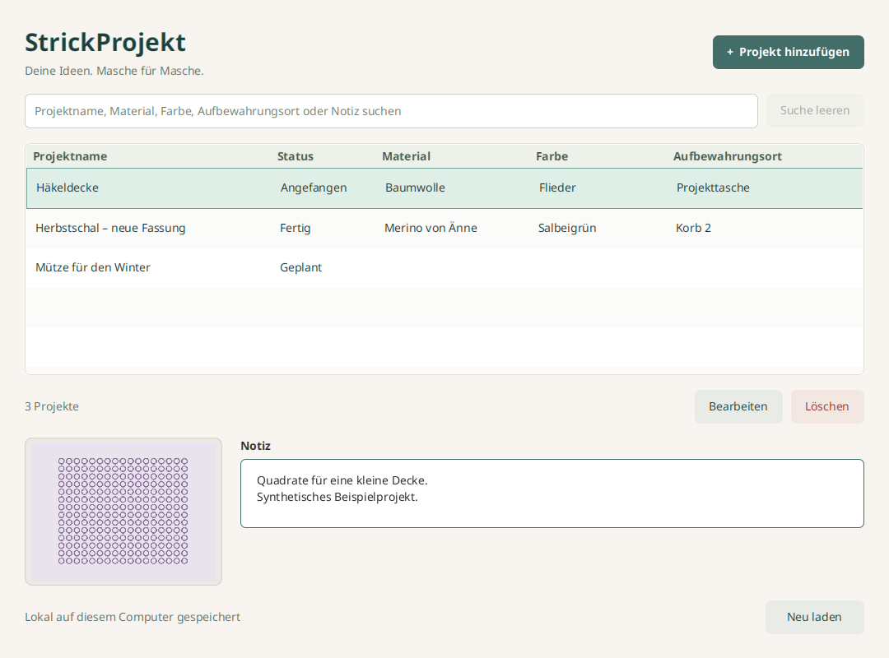

# Knitting Projects

Die [deutschen Mac-App-Store-Inhalte](docs/mac-app-store-fields.md) enthalten
Feldtexte zum Einfügen, vier reproduzierbare Linux-Bildentwürfe, eine synthetische
Beispielsammlung und den Datenschutzexport. Diese Inhaltsvorbereitung ist
getrennt von Mac-Paketierung, Signierung und nativer Abnahme. Die bestätigte
neue Apple-Bundle-ID lautet `de.appfabrik.knittingprojects`.

Deine Ideen. Masche für Masche. Verwalte kleine Strick- und Häkelprojekte mit
Projektname, Garn oder Material, Farbe, Aufbewahrungsort, Notiz und einem
optionalen Foto. Der Status zeigt **Geplant**, **Angefangen** oder **Fertig**.
Alles bleibt lokal und nach einem Neustart erhalten. Die Oberfläche unterstützt
Deutsch, Englisch, Spanisch, Französisch, Italienisch und Portugiesisch (Brasilien).



Stufe 3 der Java-Reihe BücherRegal → GarnBox → Knitting Projects → NähPlan.
KostümPlan ist die separat umgesetzte fünfte Stufe. Gegenüber GarnBox ergänzt diese App
genau den Projektstatus. Garn und Material sind Freitext ohne Verbindung zu
GarnBox. Checklisten, PDF, Zähler, Cloud und weitere Hauptfunktionen fehlen bewusst.

## Verbesserungen vom 31. Oktober 2026

Öffentlicher Name in allen Sprachen: **Knitting Projects**. Paketkennung und Datenpfade
bleiben unverändert. Neue Installationen starten auf Englisch, unabhängig von
der Systemsprache. Eine vorhandene Sprachwahl einschließlich „Automatisch“
bleibt erhalten. Die erste Store-Veröffentlichung wird auf Deutsch vorbereitet.

Hinzufügen und Bearbeiten öffnen sich zentriert über dem Hauptfenster.
Beim Laden des Editors blinkt die Tabelle nicht mehr. „Neu laden“ entfällt.
Speichern, Löschen und Import aktualisieren die Liste automatisch.

Die optionale Farbe wird über einen Farbwähler gewählt. Die Liste zeigt ein
Farbfeld und einen auch bei Auswahl lesbaren Hexwert. Bestehende Farbtexte
bleiben erhalten, bis bewusst eine Farbe gewählt oder entfernt wird.

Neu gewählte oder ersetzte Fotos werden proportional auf höchstens 1600 Pixel
an der längsten Seite verkleinert. Kleine Bilder werden nicht vergrößert.
Bilder ohne Transparenz werden JPEG mit Qualität 85 %, transparente Bilder PNG.
EXIF-Ausrichtung wird auf die Pixel angewendet, Quellmetadaten werden nicht
übernommen. Die Eingabegrenzen bleiben 10 MiB, 6000 Pixel je Seite und
16 Millionen Pixel. Originaldateien, bestehende Fotos und aus JSON
wiederhergestellte Fotobytes bleiben unverändert.
Die Fotoauswahl merkt sich den letzten bestätigten Ordner appweit und über
Neustarts hinweg in `photo-directory.txt`. Bei nicht erreichbarem Ordner wird
der Bilder- oder Benutzerordner verwendet. Abbrechen ändert die Einstellung
nicht. Die Ordnereinstellung gehört nicht zur Sammlungssicherung.

„Exportieren“ und „Importieren“ in der Fußleiste übertragen die gesamte
Sammlung als JSON, unabhängig von Suchfilter oder Auswahl. Enthalten sind
Texte, Hexfarben oder alte Farbtexte, Fotos als Base64 und der Projektstatus.

Das app-eigene Format heißt `knitting-projects.collection`, Version 1.
Import ergänzt atomar. Identische Kopien werden einschließlich ihrer Anzahl
berücksichtigt, sodass wiederholter Import keine weiteren Duplikate erzeugt.
Ungültige Dateien oder Fotos führen zum vollständigen Abbruch. Andere
App-Formate werden nicht als eigene Sicherung eingelesen. Vorhandene
Exportdateien werden nicht überschrieben.

Es gelten höchstens 10.000 Projekte, 1.048.576 Zeichen je Textfeld und 256 MiB
je JSON-Datei.
Auch der Export prüft diese Grenzen vor Übernahme der Zieldatei.
Bereits vorhandene größere Sammlungen werden nicht gekürzt. Ihre Einträge
bleiben lesbar, bearbeitbar und löschbar. Für eine vollständige Dateisicherung
außerhalb dieser Exportgrenzen die App schließen und die Datenbank kopieren.

## Sprachen und Vorschau

„Sprache“ speichert die Auswahl für den nächsten Start. Automatisch folgt der
Systemsprache. Nicht unterstützte Sprachen verwenden Englisch. `language.txt`
liegt neben der unveränderten `strickprojekt.db`. Projekttexte, Fotos und
Statuscodes werden nicht übersetzt oder migriert.

[Internationalisierung und reproduzierbare Linux-Vorschau](docs/internationalization.md)
beschreibt die sechs Store-Textfassungen, 24 echten GUI-Aufnahmen, sichere
synthetische Beispieldaten und die Ausgabe als Ordner ohne Archiv.
Die native Windows-Abnahme und endgültige Windows-Store-Bilder stehen aus.

## Starten

Build und CI verwenden Eclipse Temurin 21.0.13+9. Maven prüft Hersteller,
Version und Buildnummer. Für direkte Maven-Aufrufe auf diesem Rechner:

```bash
export JAVA_HOME="$HOME/.local/share/strickprojekt/jdk-21.0.13+9"
export PATH="$JAVA_HOME/bin:$PATH"
```

Entwicklung mit einem vollständigen JDK 21. `JAVA_HOME` zeigt auf das JDK und
`PATH` enthält dessen `bin`-Verzeichnis. Der Maven Wrapper lädt Maven und
Abhängigkeiten beim ersten Start. Die fertige App funktioniert offline.

Aus `strickprojekt/` unter Linux und macOS:

```bash
./mvnw javafx:run
```

Windows PowerShell:

```powershell
.\mvnw.cmd javafx:run
```

Im vorhandenen Linux-Workspace genügt `./scripts/run.sh`. Der Helfer findet bei
fehlendem `JAVA_HOME` auch das JDK unter `$HOME/.local/share/strickprojekt/jdk-21.0.13+9`.
Das lokal gebaute Linux-App-Image startet mit seiner eingebetteten Laufzeit:

```bash
"./target/app-image/Knitting Projects/bin/Knitting Projects"
```

## Bedienung

„Projekt hinzufügen“ und „Bearbeiten“ öffnen denselben Dialog. Nur der
Projektname ist erforderlich. Gleichnamige Projekte bleiben unabhängig.
Neue Projekte beginnen mit „Geplant“. Die Statusauswahl erlaubt jederzeit jeden
Wechsel, etwa von „Fertig“ zurück zu „Angefangen“. Der Status ist in der Liste
als Text sichtbar. Die Suche durchsucht alle fünf Textfelder unabhängig von
Groß- und Kleinschreibung, einschließlich Umlauten. Leeren zeigt alle Projekte.
Löschen verlangt eine Bestätigung.

Die Spaltenüberschriften sortieren die Liste per Klick nach Projektname, Status,
Material, Farbe oder Aufbewahrungsort. Jede Überschrift zeigt dauerhaft ein
Pfeilpaar. Die aktive Richtung wird hervorgehoben. Wiederholte Klicks wechseln
immer zwischen A–Z und Z–A, ohne die Sortierung beim dritten Klick aufzuheben.
Die Spalten bleiben fest in der Reihenfolge Projektname, Status, Material,
Farbe und Aufbewahrungsort. Überschriften lassen sich nicht verschieben.
Standard ist Projektname aufsteigend. Texte werden passend zur App-Sprache
alphabetisch und ohne Unterscheidung der Groß- und Kleinschreibung verglichen.
Status verwendet den angezeigten übersetzten Text, Farbe den Farbcode oder
vorhandenen Farbtext. Suche, Speichern und Import behalten die aktive Sortierung.
Eine weiterhin sichtbare Auswahl bleibt dem gleichen Projekt zugeordnet.

Genau ein JPEG oder PNG kann hinzugefügt, ersetzt oder entfernt werden.
Die App prüft den Bildinhalt und speichert eine eigene Kopie in SQLite.
Die Quelldatei wird niemals verändert. Nach Verschieben oder Löschen der Quelle
bleibt das Foto in der App erhalten. Grenzen: 10 MiB (10.485.760 Bytes),
6000 Pixel je Seite und insgesamt 16 Millionen Pixel.

Abbrechen der Dateiauswahl und fehlgeschlagene Importe erhalten das bisherige
Foto. Abbrechen, Escape und Fensterschließen schützen ungespeicherte Texte,
Fotoänderungen und auch eine alleinige Statusänderung mit einer Rückfrage.
„Weiterbearbeiten“ ist die sichere Vorauswahl. Speicherfehler erhalten den
vollständigen Entwurf und die Statusauswahl. Erst erfolgreiches Speichern
schließt den Dialog. Während Import und Speichern wartet er auf den Abschluss.

| Taste | Aktion |
| --- | --- |
| Strg+N / Cmd+N | Projekt hinzufügen |
| Strg+F / Cmd+F | Suche auswählen |
| Enter oder Doppelklick in der Liste | Projekt bearbeiten |
| Entf in der Liste | Nach Bestätigung löschen |
| Strg+S / Cmd+S | Dialog speichern |
| Escape | Abbrechen mit Verwerfschutz |
| Pfeiltasten in der Statusauswahl | Status auswählen |
| Enter im Notizfeld | Neue Zeile |
| Tab / Umschalt+Tab | Steuerelement wechseln |

## Daten und Prüfungen

App-Kennung: `de.appfabrik.strickprojekt`. `strickprojekt.db` enthält Texte,
Foto und Status. Nutzerdaten liegen außerhalb von Programm und Quellcode.

| System | Datenverzeichnis |
| --- | --- |
| Windows | `%LOCALAPPDATA%\StrickProjekt`, sonst `~/AppData/Local/StrickProjekt` |
| macOS | `~/Library/Application Support/StrickProjekt` |
| Linux | `$XDG_DATA_HOME/strickprojekt`, sonst `~/.local/share/strickprojekt` |

Zum Sichern die App schließen und `strickprojekt.db` kopieren. Entfernte Fotos
können in SQLite intern freien Platz hinterlassen. Die Dateigröße sinkt nicht
unbedingt sofort. Mehrere gleichzeitig bearbeitende Instanzen werden nicht
unterstützt. Keine Fotos oder privaten Datenbanken ins Git-Repository aufnehmen.

Isolierter Teststart mit einem eigenen absoluten Pfad:

```bash
./scripts/run.sh '-Djavafx.args=--data-dir=/tmp/strickprojekt-test'
"./target/app-image/Knitting Projects/bin/Knitting Projects" --data-dir=/tmp/strickprojekt-test
```

Mit JDK 21 im `PATH`:

```bash
./mvnw spotless:apply
./mvnw verify
```

`verify` umfasst 96 JUnit-Testfälle, Compiler-Lint mit Warnungen als Fehlern,
Maven Enforcer, Spotless und SpotBugs. Tests erzeugen temporäre Datenbanken
und synthetische Bilder. GUI-Prüfungen stehen im [Prüfbericht](docs/verification.md).

## Technik und Auslieferung

Java 21, JavaFX 21.0.11, SQLite JDBC 3.53.4.0, Maven 3.9.16 über Wrapper.
Ein Maven-Modul, eigenes Git-Repository und keine gemeinsame Runtime mit
anderen Apps. [Architektur und Bewerbungsgespräch](docs/architecture.md)
erklärt insbesondere „Projektstatus ändern und speichern“.

Die [Paketierung](docs/packaging.md) bereitet Windows-EXE und macOS-DMG mit
Laufzeit vor. Linux wurde mit sichtbarer Oberfläche, SQLite, Foto und Status
geprüft. Native Windows- und macOS-Tests sowie Signierung und Store-Schritte
sind offen. Ein normaler Installer ist keine geprüfte Store-Version.
Es wurde nichts gepusht oder veröffentlicht.

[Hinweise zu Fremdkomponenten](THIRD_PARTY_NOTICES.md).

## Datenschutz und Fokusrahmen

„Info“ öffnet die vollständige Datenschutzerklärung offline in der ausgewählten
App-Sprache. Der Dialog ist scrollbar, schreibgeschützt und kopierbar.
Escape oder „Schließen“ führen zurück. Er wird erst nach der Positionierung
sichtbar, damit die anfängliche Korrektur der Fensterposition verborgen bleibt.
Die Erklärung beschreibt die tatsächlich gespeicherten Texte, Fotos und die
jeweiligen Projektfunktionen. Originalfotos werden nicht verändert.

Löschschaltflächen erhalten einen roten Fokusrahmen. Die übrigen Schaltflächen
behalten die jeweilige App-Farbe. Die Auswahlfläche der Tabelle bleibt sichtbar,
der zusätzliche Rahmen der fokussierten Tabellenzeile ist transparent.

Die sechs identischen Texte für Partner Center lassen sich aus den Ressourcen
in einen neuen Ausgabeordner exportieren:

```bash
./scripts/export_privacy.sh target/privacy-texts
```

Ein vorhandener Ausgabeordner wird nicht überschrieben. Die vorhandenen
Prüfbedingungen für Vorschau-Lieferungen bleiben bestehen. Der neue Datenschutz-
ordner wird erst mit einer erneut geprüften Lieferung erzeugt.

## App-Icon und Ubuntu-Anwendungsmenü

Die App enthält ihr eigenes Icon für Fenster und Dialoge. Windows-Pakete verwenden
ICO, macOS-Pakete ICNS. Ubuntu ordnet das laufende Fenster über einen passenden
Anwendungseintrag demselben Icon zu.

Nach dem Linux-App-Image-Bau aus diesem App-Verzeichnis registrieren:

```bash
python3 "target/app-image/Knitting Projects/install_desktop.py"
```

Danach lässt sich die App über ihren Namen in der Ubuntu-Anwendungsübersicht
starten und bei Bedarf vom Nutzer im Dock anheften. Der Installer benötigt
Python 3, keine Administratorrechte und verändert keine Sammlung.
Mit `--data-dir=/absoluter/pfad` kann der Eintrag eine bereits verwendete eigene
Sammlung öffnen. Ohne diese Option gelten die normalen Datenpfade der App.
Beim Verschieben des App-Images den Installer vom neuen Speicherort erneut
aufrufen. Einen geöffneten Prozess anschließend regulär neu starten.
