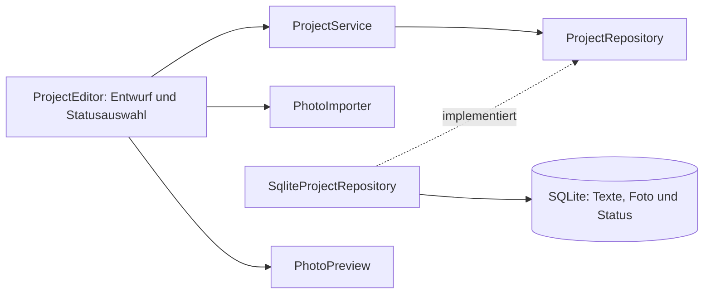

# Architektur und Bewerbungsgespräch

StrickProjekt hat ein Maven-Modul mit fünf kleinen Bereichen. Fotoimport,
SQLite-Zugriff und Dialogführung wurden aus GarnBox gezielt angepasst. Die App
besitzt eigene Quellen, Kennungen, Datenpfade und ein eigenes Git-Repository.
Sie benötigt keine andere App zur Laufzeit. Der fachliche Unterschied ist
`ProjectStatus`, keine neue Infrastruktur.

| Bereich | Aufgabe |
| --- | --- |
| `domain` | Records `Project`, `ProjectDraft`, unveränderliches `Photo` und Enum `ProjectStatus` |
| `application` | Anlegen, Ändern, Löschen, Suche, Bildprüfung und Repository-Vertrag |
| `persistence` | Benutzerdatenpfad, Schema-Version, JDBC, atomare SQL-Anweisungen |
| `i18n` | Sechs UTF-8-Kataloge, feste Sprache pro App-Start und regionale Zahlen |
| `ui` | JavaFX-Fenster, Arbeitsentwurf, Statusauswahl, Vorschau, Hintergrundaufgaben |

`ProjectsApplication` verbindet die Komponenten durch Konstruktoren. Die
Anwendungslogik kennt weder JavaFX-Steuerelemente noch JDBC. Die Pflichtfeldregel
sitzt im kompakten Konstruktor von `ProjectDraft`. Unicode-Leerraum allein reicht
nicht als Projektname. Optionale einzeilige Felder werden außen bereinigt,
Formatierung und Zeilenumbrüche der Notiz bleiben unverändert.

## Status als fester Wertebereich

| Java-Enum | Gespeicherter Wert | Deutsche Anzeige |
| --- | --- | --- |
| `PLANNED` | `planned` | Geplant |
| `STARTED` | `started` | Angefangen |
| `FINISHED` | `finished` | Fertig |

`storedValue()` ist der stabile Speicherschlüssel. `Messages.status()` liefert
den übersetzten Text außerhalb des Domänenmodells. Es wird weder `ordinal()` noch der übersetzte Text gespeichert.
Eine Umordnung der Enum-Konstanten oder geänderte übersetzte Beschriftungen
beeinflussen die vorhandenen Daten damit nicht. `fromStoredValue()` übersetzt
beim Lesen explizit zurück. Unbekannte Werte erzeugen einen verständlichen
Speicherfehler. Sie werden niemals still auf Geplant zurückgesetzt.

Ein neuer `ProjectDraft` ohne expliziten Status verwendet `PLANNED`. Der Editor
wählt denselben Standard. `null` ist kein gültiger Status. In SQLite schützt
zusätzlich `NOT NULL DEFAULT 'planned' CHECK (status IN (...))` den Wertebereich.
Alle drei Werte dürfen direkt ineinander übergehen. Es gibt weder eine
Übergangsmatrix noch Zeitstempel, Statushistorie oder automatische Änderungen.

Die `ComboBox<ProjectStatus>` ist nicht editierbar und enthält die drei
Enum-Werte. Ihre Zellen verwenden `Messages.status()`. Die Tabelle zeigt denselben
Text. Damit ist die Kennzeichnung unabhängig von Farbe.

## Ablauf: Projektstatus ändern und speichern

1. Die Liste enthält leichte `Project`-Records mit Texten, `hasPhoto` und Status.
   Beim Bearbeiten wird das zugehörige Foto im Hintergrund geladen. Scheitert
   das Laden, öffnet sich kein Dialog mit versehentlich verlorenem Foto.
2. `ProjectEditor` übernimmt Texte, Foto und den gespeicherten Enum-Wert.
   Sein ursprünglicher `Input`-Record hält den Vergleichszustand. Die Auswahl
   „Fertig“ ändert zunächst nur den lokalen Entwurf.
3. Speichern liest einen vollständigen `ProjectDraft`. Projektname und Status
   werden validiert. `ProjectService.save(id, draft)` entscheidet anhand der ID
   zwischen Anlegen und Ändern, ohne irgendwelche Statusübergänge einzuschränken.
4. `AsyncTasks` führt den Repository-Aufruf außerhalb des JavaFX-Threads aus.
   Ein `PreparedStatement` bindet fünf Texte, ein optionales BLOB und
   `draft.status().storedValue()`. Ein einziges UPDATE ändert die vollständige
   Zeile. Die interne ID bleibt erhalten. INSERT verwendet denselben Ablauf
   für ein neues Projekt.
5. SQLite speichert Texte, Foto und Status gemeinsam atomar. Bei einer reinen
   Statusänderung werden dieselben Texte und Bildbytes wieder gebunden.
   Ein Fehler lässt keine teilweise gespeicherten Projektinhalte zurück.
6. Erst der erfolgreiche JavaFX-Callback aktualisiert die Liste und schließt
   den Dialog. Bei Fehlern bleibt der ganze Entwurf samt Statusauswahl und
   Vorschau zum erneuten Speichern sichtbar.

Abbrechen, Escape und Fensterschließen vergleichen `input().equals(original)`.
Da der `Input`-Record auch den Status enthält, erkennt der Vergleich eine reine
Statusänderung. „Weiterbearbeiten“ ist die sichere Vorauswahl der Rückfrage.
Verwerfen schreibt nichts in die Datenbank. Während Speichern und Fotoimport
sind konkurrierende Dialogaktionen gesperrt.

## Foto, Suche und Hintergrundarbeit

Genau ein nullable BLOB liegt neben den Texten und dem Status in derselben
Tabellenzeile. So gibt es keine verwaisten Bilddateien oder unvollständigen
Dateiverweise. DELETE entfernt auch das Foto. Eine geschlossene Datenbankdatei
genügt für eine manuelle Sicherung. SQLite kann freien Platz intern behalten.

`PhotoImporter` übernimmt die bewährten Grenzen aus GarnBox: 10 MiB,
6000 Pixel je Seite und 16 Millionen Pixel insgesamt. Er prüft den Inhalt mit
ImageIO, liest höchstens das Limit plus ein Prüfbyte und prüft die Abmessungen
vor dem vollständigen Decodieren. Nur JPEG und PNG sind erlaubt. Decoderfehler
und Warnungen führen zur Ablehnung. Der Dateifilter allein wäre keine Prüfung.

Import und JavaFX-Vorschau werden im Hintergrund decodiert. Erst nach Erfolg
beider Schritte wird das Entwurfsfoto ersetzt. `Photo` verwendet defensive
Arraykopien und inhaltsbasiertes `equals`/`hashCode`. Originaldateien werden nie
verändert. Ein Generationszähler in `PhotoPreview` verwirft verspätete Callbacks,
damit nach Auswahlwechseln kein fremdes Projektfoto erscheint.

Ein einzelner Executor ordnet die überschaubaren Speicher- und Bildaufgaben.
JavaFX-Task-Callbacks aktualisieren Steuerelemente ausschließlich auf dem
UI-Thread. `try-with-resources` schließt JDBC-Verbindungen, Statements und
Resultate auch bei Fehlern. SQL-Parameter behandeln Namen mit Anführungszeichen
als Daten. Die Schema-Version verhindert das Öffnen einer unbekannten neueren
Datenbankversion.

Die Suche arbeitet über alle fünf Textfelder der geladenen Records.
Unicode-Normalisierung NFC und `Locale.ROOT` machen Umlautsuche unabhängig von
Groß- und Kleinschreibung. Ein `Collator` der gewählten Sprache sortiert die Ergebnisse.
Die ID unterscheidet gleichnamige Projekte. Für kleine lokale Sammlungen genügt
die lineare Suche. Status ist eine Auswahl und kein zusätzliches Freitextfeld.

## Zusätzliche Java-Kenntnisse gegenüber GarnBox

| GarnBox als Grundlage | Neu in StrickProjekt |
| --- | --- |
| Records für Texte und Foto | Enum als fester fachlicher Wertebereich |
| Einfache Freitextfelder | Typisierte, nicht editierbare `ComboBox<ProjectStatus>` |
| Speicherung von Text und BLOB | Explizite Trennung von Enum, Speicherschlüssel und übersetzter Anzeige |
| Gemeinsames UPDATE | Atomare Erweiterung um Status mit SQLite-CHECK und Default |
| Vergleich des Text- und Fotoentwurfs | Record-Gleichheit erkennt auch alleinige Statusänderungen |
| Foto- und CRUD-Tests | Parametrisierte Tests aller Statuswerte und aller Wechsel in beide Richtungen |

Für das Gespräch: „Der Status ist kein beliebiger String. Ein Enum erlaubt
nur drei fachliche Werte. Ich speichere einen expliziten stabilen Schlüssel.
Der Dialog hält Änderungen zunächst in einem Entwurf. Ein einzelnes SQL-UPDATE
speichert alle Inhalte zusammen. Erst nach Erfolg schließt der Dialog.
Ein Test bricht die Änderung durch einen SQLite-Trigger ab und prüft, dass
Texte, Foto und Status vollständig auf dem alten Stand bleiben.“

## Grenzen und nachvollziehbare Quellen

Eine kleine lokale Sammlung und eine bearbeitende App-Instanz sind das Ziel.
EXIF-Rotation und Farbprofile werden nicht eigens aufbereitet. Native Windows-
und macOS-Abnahmen bleiben erforderlich. Checklisten und PDF gehören zu späteren
Portfolio-Stufen und haben hier weder Menüs noch vorbereitete Implementierungen.

Die Entscheidungen zur Auswahl und Fehlerbehandlung wurden mit der offiziellen
[JavaFX-21-ComboBox-Dokumentation](https://openjfx.io/javadoc/21/javafx.controls/javafx/scene/control/ComboBox.html)
und dem [SQLite-Verhalten bei ABORT](https://www.sqlite.org/lang_conflict.html)
abgeglichen. Die Tests prüfen das tatsächliche Verhalten des verwendeten Treibers.

## Sprachwahl und Fehlercodes

`ProjectsApplication.init()` liest die kleine app-lokale Einstellungsdatei und
legt eine unveränderliche `Messages`-Instanz für Fenster und Worker-Rückmeldungen
an. Die automatische Auswahl folgt der Systemsprache. Englisch ist die feste
Rückfallsprache. Die Sortierung nutzt die gewählte Sprache. Unicode-Suche und
Originaltexte bleiben unabhängig von den übersetzten Beschriftungen.

`LanguagePreferences` ersetzt `language.txt` atomar. Die Datenbank wird dabei
nicht geöffnet oder geändert. Ein Schreibfehler erhält den Dialog und seine
Auswahl. Ein Lesefehler wird in der verwendeten Systemsprache angezeigt.
`StorageException.Code` und `PhotoException.Code` geben stabile Fehlerkategorien
an die Oberfläche. Erst dort entstehen die übersetzten, sicheren Meldungen.
